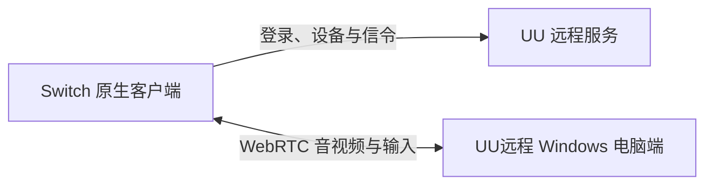

# YOUYOU远程 · Nintendo Switch

**在 Nintendo Switch 上远程操作自己的 Windows 电脑。**

基于 C++17 / libnx 的非官方自制客户端，使用 UU 远程账号连接电脑，接收画面和声音，并通过手柄、键鼠映射或触屏进行操作。项目基于 [Antman2023/UURemote-ns](https://github.com/Antman2023/UURemote-ns)，与网易、任天堂无隶属或背书关系。


[](LICENSE)

[安装使用](#安装使用) · [按键操作](#按键操作) · [当前限制](#当前限制) · [源码构建](#源码构建) · [文档导航](docs/README.md) · [更新记录](CHANGELOG.md)

> **当前源码版本：0.4beta（内部版本 0.4.0）。** 本版整合 R67 性能优化、TV 反馈适配、两路手柄与外设界面，以及连接、断开、屏幕保护和指针修复。测试 NRO、源码快照、校验值和许可文件见 [0.4beta 预发布](https://github.com/doke69/YOUYOU-Remote-ns/releases/tag/v0.4beta)。完整变化及验证边界见[更新说明](docs/releases/v0.4beta.md)。

## 功能与验证状态

当前源码包含：

- **账号与设备**：扫码或短信登录、本地会话恢复、手动刷新电脑列表，并记住上次成功连接的电脑。
- **画面与声音**：H.264 / H.265 接收、Opus 音频、NVDEC 硬解和 Deko3D NV12 显示路径；不可用时存在回退路径。
- **画质与网络**：省流 5、清晰 12、高清 20、原画 30 Mbps 上限快捷档，自定义码率入口暂时隐藏；网络页可查看连接通道、实际接收码率和诊断信息。
- **操作方式**：两套键鼠映射、实验性双玩家 Xbox 兼容手柄直连、手机式鼠标触屏与平板多点触控。
- **桌面操作**：Windows 快捷操作、剪贴板确认粘贴及部分安全设置。
- **屏幕保护**：安全页集中提供“隐私保护”和“关闭显示屏”两个互斥开关；点击已开启项即可关闭，界面跟随电脑实际状态，未知或等待时明确提示。
- **鼠标指针**：每轮连接画面和设置通道就绪后自动请求开启电脑端光标捕获，保留“外设 → 鼠标设置 → 恢复鼠标指针”手动入口。

| 验证项目 | 当前结果 |
| --- | --- |
| 0.4beta 整合验证 | 结果见[整合检阅记录](docs/reviews/v0.4beta-integration.md)，整合版真机回归待完成 |
| R67 性能候选 | 有一次真机反馈“基本相同，未见异常”，仍有恢复停顿 |
| 720p / H.265 串流 | 已有真机使用反馈，实际表现随设备、场景和网络变化 |
| 双玩家、横握 Joy-Con、震动 | 代码与本机检查已覆盖，完整双人游戏和适配器兼容仍需实测 |
| 隐私／息屏重连与自动光标恢复 | 报告场景已由用户复测确认；其他电脑版本与显示环境仍需验证 |
| 电脑键盘入口 | 已实现快捷键请求，此前测试有未弹出反馈 |

新安装默认配置为 **720p / 60 FPS、H.265、12 Mbps 上限、垂直同步关闭、0 ms 播放缓冲、手柄模式（远程按键按字母）**。本版按下方流程全新安装，首次启动重新登录并配置。档位值表示请求上限，程序不会自动超频。详见[项目状态](docs/project-status.md)与[本版说明](docs/releases/v0.4beta.md)。

## 安装使用

准备可运行自制程序的 Switch、安装官方 UU远程并登录的电脑，以及用于扫码的手机。只连接你有权控制的电脑。

1. **0.4beta 请全新安装。** 正常退出旧程序，将需要留存的旧文件夹备份到电脑，然后清空 SD 卡上的 `switch/UURemote-ns/` 文件夹全部内容。不要把旧配置、会话或其他旧文件复制回新目录。
2. 从 [0.4beta 预发布](https://github.com/doke69/YOUYOU-Remote-ns/releases/tag/v0.4beta) 下载 `UURemote-ns.nro`，或按[源码构建说明](docs/build.md)自行构建。放入清空后的目录，得到 `switch/UURemote-ns/UURemote-ns.nro`。首次启动需重新登录并配置。下载后可用附件 `SHA256SUMS.txt` 核对文件。
3. 在电脑上打开官方 UU远程，登录并保持在线。
4. 在 Switch 使用 **完整应用模式**进入 sphaira / hbmenu，例如按住 **R** 启动游戏，再打开 YOUYOU远程；不要以相册小程序模式比较性能。
5. 使用手机官方 App 扫码确认，或选择短信登录。已有有效会话时程序会尝试恢复登录。
6. 刷新并选择在线电脑，进入桌面。设备身份可能显示为 TV，设备名为 Switch 主控端；本项目并非官方 Switch 客户端。

```text
SD 卡根目录/
└── switch/
    └── UURemote-ns/
        └── UURemote-ns.nro
```

完整流程、配置和故障排查见[使用手册](docs/user-guide.md)。

## 按键操作

| 场景 | 按键 | 行为 |
| --- | --- | --- |
| 首页 | 长按 **＋** | 退出应用；从加载器启动时通常返回加载器 |
| 串流 | **−** | 按当前映射发送远程按键 |
| 外设 → 手柄设备 | 操控模式 | 选择键鼠／手柄并确认 |
| 串流 · 两种模式 | 按住 **L**，再按 **＋** | 打开或收起本地菜单 |
| 串流 · 手柄模式 | 按一下 **＋** | 向电脑发送 Xbox Start / Menu |
| 本地菜单 | **右侧面键 / 下侧面键 / 摇杆或方向键** | 确认 / 返回 / 选择；也可触屏 |

Xbox 对应 **LB + Start**，PS 手柄对应 **L1 + OPTIONS**，横握右 Joy-Con 对应 **SL + ＋**；左 Joy-Con 使用另一只手柄或触屏进入菜单。

键鼠方案、Xbox 布局和触屏模式可在菜单中设置；详细映射见[按键与输入模式](docs/user-guide.md#按键与输入模式)。

## 当前限制

- 原生 IPv6 尚未交付；TURN TCP/TLS 及不同网络环境的完整互通仍需验证。显示 P2P 或 TURN 以本次实际连接路径为准。
- 切换部分画质或编码设置可能需要重连；电脑端不一定回报实际采用的码率。
- 本版构建脚本使用 R67 的 TWCC-01 与 RBE 回退配置。反馈支持、电脑执行和实际码率须分别核对。中继自动请求最高 20 Mbps，实际线路流量不是硬性 20 Mbps 限速。
- 音频暂存和补偿不等于完整音画同步；自动解锁尚未实现，安全设置的实际执行仍需按电脑端验证。
- 解码耗时包含处理与等待，不等于纯硬件时间或端到端操作延迟；50–100 Mbps 稳定串流尚无保证。

连接异常时，可先查看[诊断说明](docs/live-diagnostics.md)；公开分享日志或崩溃报告前请检查并去除账号、网络地址及其他敏感信息。完整边界见[项目状态](docs/project-status.md)。

## 源码构建

```sh
git clone https://github.com/doke69/YOUYOU-Remote-ns.git
cd YOUYOU-Remote-ns
```

需要 CMake、Ninja、Python、devkitPro Switch 工具链及项目所需依赖。构建需自行准备兼容的本地认证材料；仓库不包含该材料或 UU APK。完整依赖、资源模式、命令和分发边界见[构建说明](docs/build.md)及[分发说明](docs/distribution.md)。

使用完整应用模式运行生成的 NRO。公开源码不会自动构成可分发的完整安装包；构建及使用参考材料前，请自行确认相应授权。

## 技术结构



libcurl 处理 HTTPS / TLS WebSocket；libdatachannel 及其依赖处理 ICE、DTLS、SRTP 和 SCTP；FFmpeg / Opus 负责解码，SDL2 与 deko3d 用于界面、音频和显示。项目目录、研究记录及诊断入口见[文档导航](docs/README.md)。

## 许可证与致谢

项目代码使用 [GPL-3.0-or-later](LICENSE)，依赖和字体分别遵循其许可，详见[第三方许可](THIRD_PARTY.md)及[来源与致谢](docs/credits.md)。感谢上游 UURemote-ns 作者、相关开源项目维护者以及提供真机反馈的测试者。

项目是非官方适配，与网易、任天堂无隶属或背书关系；UU 品牌和相关材料归各自权利人所有。仓库不包含 UU APK、签名材料或用户会话。若对来源或许可有疑问，请通过仓库 Issues 联系维护者。

## 🥤 请我喝瓶可乐

如果 YOUYOU远程 对你有帮助，欢迎请我喝瓶可乐。感谢你的支持，让我更有动力继续维护和改进！

**完全自愿，所有公开功能均可免费使用。**

<p>
  
</p>

使用支付宝扫一扫，或保存图片后在支付宝中识别。
